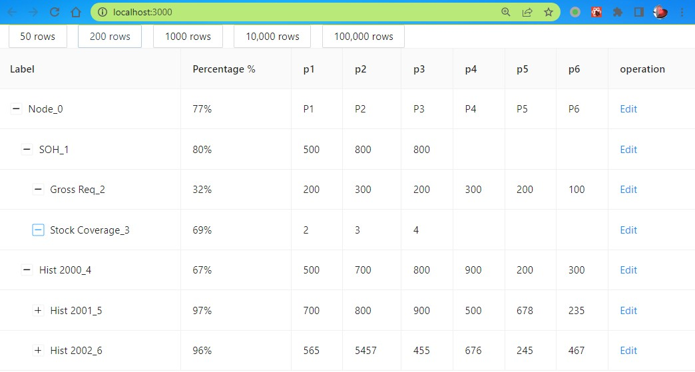
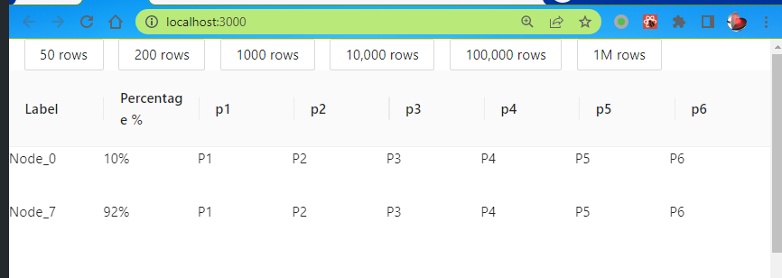

# #36153 虚拟列表 + 树形 Table（10 万行）渲染问题

## 现象
需求：10 万行 + 树形层级 + 排序 + 过滤 + 不分页 + 流畅滚动。直接 antd-table：1 万行时排序/展开/折叠就开始可感卡顿，10 万行时页面任何操作都极卡。用户发现官方虚拟列表示例（`rc-virtual-list` 的 Grid 实现）速度极快，问能否把虚拟列表"嫁接"到带 `children` 树形结构的原生 Table 上。

## 复现 / 触发条件
- antd 4.x / 5.x Table + Tree (children 属性)
- 数据规模 1w 起显著，10w 完全不可用
- 任何排序/过滤/展开/折叠操作都会触发整树 re-render

## 期望 vs 实际
- 期望：树形 Table + 虚拟滚动叠加，10w 行操作流畅。
- 实际：antd 官方虚拟方案与树形展开折叠互不兼容，2022 时无现成方案。

## 根因 / 关键讨论
2022 年时 antd 官方虚拟列表示例基于 `rc-virtual-list` 的 Grid，是"扁平 + 固定行"模式，无法承载 `children` 嵌套展开。huntdream 反问"你要的是虚拟列表的树形表格吗"得到肯定答复；2 年后（2024-05/06）仍有 zengpeiceng、Veveue 回帖问"实现了吗 / ali-react-table"——长期无人给 antd 方案。

## 关联图片

## 对 data-grid 的启示
这是 antd 长期空白：虚拟滚动与树形/合并单元格功能二选一。CSS Grid 重做时，应在一开始就让虚拟滚动支持"非扁平行"——通过 flatten 后保留 rowSpan / indent / 层级状态来支持树形虚拟化，避免重蹈"虚拟+树形不兼容"的覆辙。
