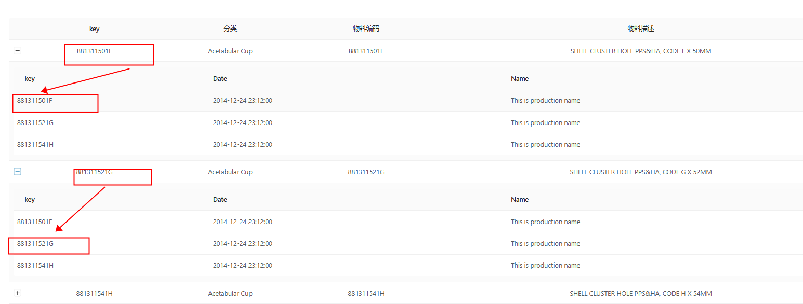

# #50677 antd 4.17.4 table 嵌套子表格联动失效

## 现象
OP 想实现"点击外层一行 → 只展开这一行对应的子数据"，但实际行为是"点开一行 → 所有行的子数据全部展开"。OP 误以为只要给 `expandedRowRender` 设置好 key，组件就会自动按 key 过滤关联子数据，结果不是这样。

## 复现 / 触发条件
- antd 4.17.4，使用 `expandable.expandedRowRender` 渲染子表格。
- 把所有行的子数据塞进同一个大数组里传给 `dataSource`，期望组件按 key 自动分流。
- 代码片段（OP）：https://paste.ofcode.org/5nrLAZSKkaCPeyaWLBT9wC

## 期望 vs 实际
- 期望：点哪一行，只有那一行的子数据被渲染。
- 实际：点任意一行，所有子数据都被渲染出来。

## 根因 / 关键讨论
社区解答（被采纳 Answered）的核心：
1. antd Table 不会自己过滤数据——`expandedRowRender` 里收到的就是 `record`，组件把"data 传进去什么就渲染什么"，需要开发者自行在 `expandedRowRender` 内部按 `record.key` 把子数据 filter 出来。
2. 关于"合并子表格中物料编号和描述"，需要在子表的 `columns` 里对相应列 `onCell` 返回 `colSpan` 实现；OP 反馈"插了 onCell 还是没生效"，社区建议直接做 codesandbox 复现，并指向了 `ant-design/pro-components#8701` 作为参考方向。
3. 通用教训：`expandedRowRender` 是纯渲染回调，不带状态管理；要"联动"，必须自己在外层维护 `expandedRowKeys` + 子数据映射。

## 关联图片
-  — OP 当时的渲染效果（点一行展开全部）

## 对 data-grid 的启示
1. data-grid 的 `expandable.expandedRowRender(record, index)` API 应在文档里**显式说明**："组件不会按 key 过滤子数据，请在 render 内根据 record 自行取数"，否则用户会重复踩 OP 的坑。
2. 考虑提供"声明式"的便捷 API：`expandable.nestedDataKey={(record) => record.children}` + 自动按 key 分组，省去用户手写 filter；但要保持 `expandedRowRender` 仍是逃生口。
3. `expandedRowKeys` 受控语义必须稳定（与 antd 对齐：受控时组件不再自动维护展开状态），文档里给"受控 vs 非受控"两种最简例子，避免用户混合写法导致全展开。
4. 子表内合并单元格（colSpan）应在外层和内层 Table 一致支持，复用同一份 `onCell` 规约，避免"外层有效、内层无效"这类反馈。
