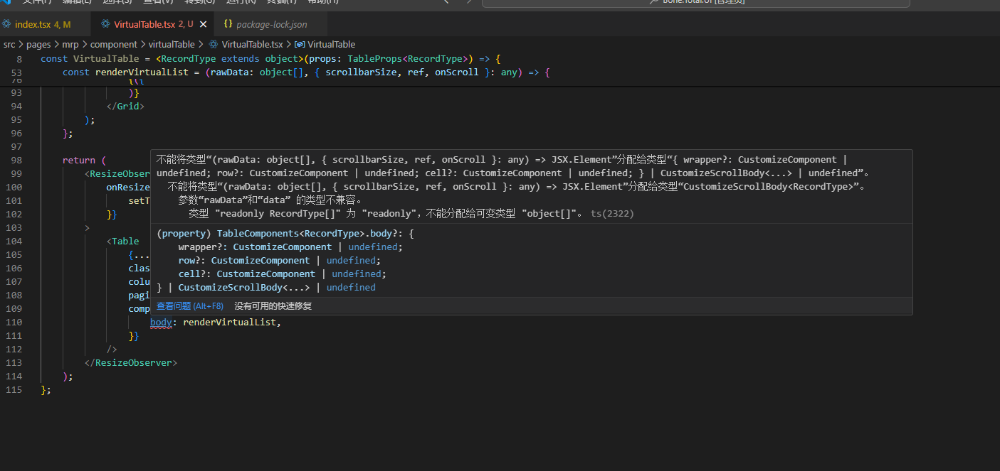

# #51615 VirtualTable 表格按照文档无法使用（参照版本 4.24.12）

## 现象
用户在 antd 4.17.4 项目中参照 4.24.12 版本官方文档实现 VirtualTable，TypeScript 报错、API 不匹配，无法直接落地。

## 复现 / 触发条件
- antd 钉死在 4.17.4（项目耦合深，无法升级）
- 文档参考 `4x-ant-design.antgroup.com/.../components/table-cn/#components-table-demo-virtual-list`
- 业务还耦合了 pro-table 2.50.0、react-window 1.8.5、umi 3、React 16.13

## 期望 vs 实际
- 期望：照 4.24 文档抄就能跑。
- 实际：4.17.4 上 API 形态不一致，TS 报错，作者"找不到 4.17.4 对应的文档"。

## 根因 / 关键讨论
纯属版本错配 + 文档归档缺失。维护者 zombieJ 给出追旧版文档的方法：「checkout repo 到 4.17.4 的 Tag 然后 `npm start` 就是文档了」。作者最终靠 AI 改示例代码绕过。并附最终可用的示例：`paste.ofcode.org/37XQFwBgFsw6sqcFxnVAptn`。

## 关联图片

## 对 data-grid 的启示
本身技术含量低，但侧面反映两点：(1) antd v4 的 VirtualTable 是"组合式"（rc-virtual-list + 自定义 components）而非一体 API，迁移成本高 → data-grid 应直接提供一等公民 `virtual` prop；(2) 文档应同时维护历史版本入口，避免用户被迫 checkout 旧 tag 自建文档。
