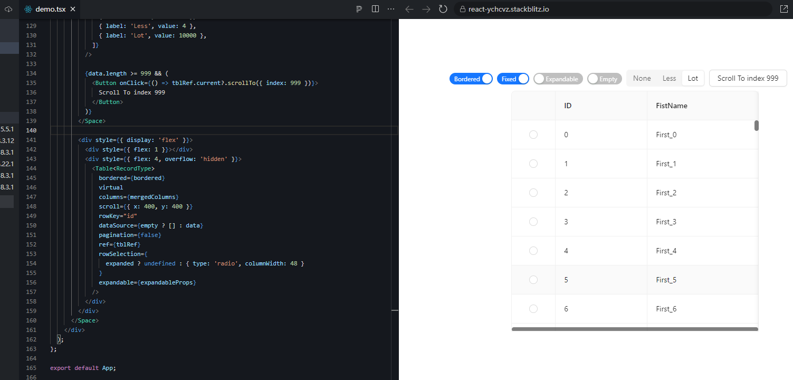

# #51650 Virtual Table + flex + overflow:hidden 偶现多余横向滚动条

## 现象
虚拟表格位于 flex 容器中、父元素 `overflow: hidden` 时，即使横向空间足够显示所有列，仍**偶现**一条多余的横向滚动条。

## 复现 / 触发条件
- 父容器使用 flex 布局 + `overflow: hidden`
- `<Table virtual />` 列宽合计小于父容器宽度（应当不溢出）
- 官网 stackblitz 示例 `react-ychcvz` 即可复现
- 关键词："偶现"，与 ResizeObserver/异步布局度量时机相关

## 期望 vs 实际
- 期望：未溢出时不显示横向滚动条。
- 实际：偶尔多出一条横向滚动条，影响视觉一致性。

## 根因 / 关键讨论
官方未给出实质答复，只有机器人 petercat 列了通用可能性（宽度计算误差 / 浏览器渲染差异 / 样式冲突 / 版本）。未 Answered。结合 #50957 推测：flex 容器的 content-based 宽度计算与虚拟表格内部同步测量的时刻不同步，父级 `overflow:hidden` 不参与滚动条占位计算，虚拟列表内部初始渲染时把 scrollWidth 临时算大了 1~2px。

## 关联图片

## 对 data-grid 的启示
CSS Grid 重做 Table 时，应避免在 flex 父容器下用"测量-设宽"的同步链条；可直接用 `grid-template-columns: minmax(0, ...)` + 容器查询，让浏览器自己算溢出，或在测量宽度时减去 `clientWidth - scrollWidth <= 1px` 容差再决定是否启用滚动条。
