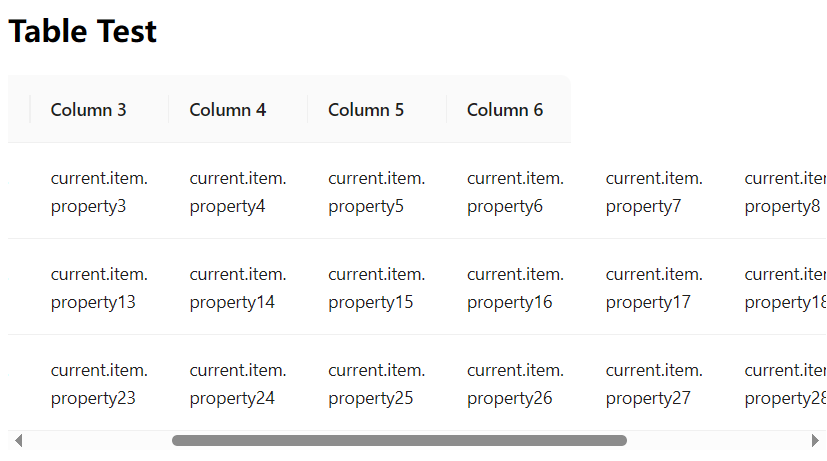

# #54414 sticky + 外层 overflow:auto + 显式列宽 → 横向滚动时列头截断

## 现象
Table 设置 `style={{ overflow: 'auto' }}`（外层 wrapper 滚动）+ `sticky={true}`（表头吸附）+ 列显式 `width: '111px'`，左右滚动时**表头被截断**（表头与表体的横向滚动不同步）。
- 用 `scroll.x=true` 能规避截断，但副作用是未指定 width 的列会被撑得过宽，把表格整体顶开。
- 作者真正想要的：不开 `scroll`，让 sticky + overflow:auto 的表头不截断，且未指定列宽的列**均分剩余空间**而非顶开表格。

## 复现 / 触发条件
- antd Table + `sticky` + 外层 `overflow: 'auto'` + 部分列显式 width + 部分列不设 width
- demo：10 列、每列 `width: '111px'`、3 行数据、`pagination={false}`、`sticky={true}`、`style={{ overflow: 'auto' }}`

## 期望 vs 实际
- 期望：sticky 与外层 overflow:auto 协调，表头随表体同步滚动；未指定列宽的列均分剩余宽度。
- 实际：表头被截断（不同步）；要么用 scroll.x 修同步但列被撑宽，要么忍受截断。

## 根因 / 关键讨论
dosubot 一句话定性：「sticky 表头的正确实现依赖 `scroll.x` 属性来同步表头和内容区的宽度与滚动，否则会错位或截断」。即 antd sticky 是基于 scroll.x 内部建立的"表头/表体双容器 + 同步滚动"机制，外层用户自加的 overflow:auto 完全绕过它，二者各滚各的，所以错位。Chrome 136+ 尤其明显，137 部分修复（关联 #53711）。无官方方案，权宜：
- `<Table tableLayout="auto" />` + `.ant-table-body table { table-layout: auto !important; }`
- 5.21.0+ 用 `minWidth` + `tableLayout="auto"`
- 必须 sticky + 横滚时，所有列都设 width 且和 ≤ scroll.x（关联 #53915、#54000）

## 关联图片

## 对 data-grid 的启示
CSS Grid 重做 Table 的天然优势：**表头与表体共享同一个 `grid-template-columns`**，二者本就是同步的——sticky 表头只是 `position: sticky; top: 0` 的 grid item，不需要额外的"同步滚动"机制。再配合 `minmax(0, 1fr)` 让未指定列宽的列均分剩余空间而不顶开容器，即可同时满足作者的两个诉求（不截断 + 均分），彻底绕开 antd 这种"sticky 与外层 overflow 互斥"的架构债。
