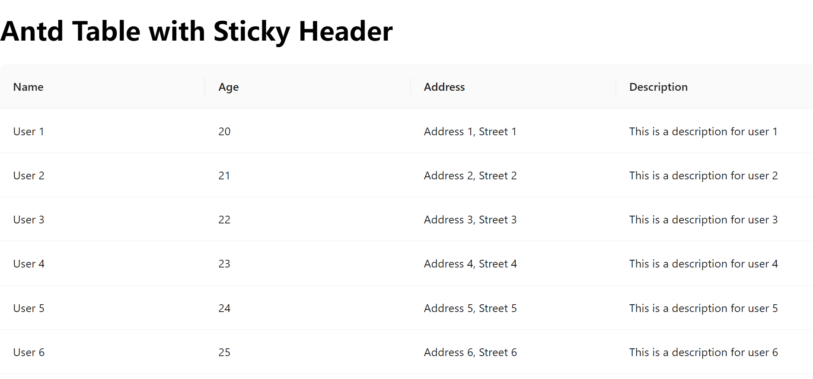

# #55265 窗口变宽表格变宽，变窄却不缩（sticky + fixed + flex 不对称缩放）

## 现象
使用 antd 5.27.4，启用 `sticky` + `tableLayout='fixed'`，body 是 `display: flex` 布局，**窗口变大→表格跟着变大**，但**窗口变小→表格不跟着变小**，导致页面底部出现横滚动条。作者认为这是不对称行为（应双向同步）。

## 复现 / 触发条件
- Vite + react-ts 模板，antd ^5.27.4。
- `body { margin: 0; display: flex; }`。
- Table 4 列均**未指定 width**，`sticky` + `tableLayout='fixed'`。
- 浏览器 Ctrl+滚轮先缩小（窗口变大）再放大（窗口变小）。

## 期望 vs 实际
- 期望：表格宽度随窗口对称伸缩。
- 实际：放大后无法缩回，残留横滚动条。

## 根因 / 关键讨论
dosubot 解释：这是 antd 已知限制，`sticky + tableLayout='fixed'` 在 flex 布局下宽度伸缩不对称（变宽扩张，变窄不收缩），非最近版本引入。
- workaround：① 用 `scroll.x`（但未指定列会变很宽）；② `tableLayout='auto'` + 自定义 CSS；③ 至少留一列不指定宽度。
- 作者反驳：示例代码中**所有列都未指定宽度**，按 workaround ③ 应能缩，实际仍未缩。
- 作者最终方案：**删除 antd `sticky` 属性**，改用 CSS `th { position: sticky; top: 0; z-index: ... }`，问题消失。吐槽："不知道为什么 antd 的 sticky 会搞出两个表格那么复杂的实现"。

## 关联图片
- 

## 对 data-grid 的启示（★ 蛇打七寸）
1. **antd sticky 的"双表格"实现是病根**：作者直接戳破 antd sticky 用"两个表格"（表头表体分离）实现，导致固定布局下宽度伸缩不对称。**data-grid 用 CSS Grid 单一 grid 容器**，表头与表体共享同一 grid track，天然对称伸缩——这是结构性根治。
2. **flex 布局是默认测试矩阵**：用户业务场景里 `body display: flex` 极常见，data-grid 必须在此场景下双向对称伸缩。已有 `demo-compare-framework.md` 约定 SplitDemo 用 flex，应加"resize 窗口双向跟手"为验证项。
3. **CSS `position: sticky` 原生方案胜过 antd 复杂实现**：作者最终用原生 CSS sticky 解决，证明 antd 的复杂方案 over-engineered。data-grid 表头粘性应直接用 `position: sticky` 在 grid header cell 上，不要拆双表格。
4. **避免 antd"窗口变宽→变窄"陷阱**：data-grid 应增加自动化测试——浏览器窗口尺寸变化时表格宽度严格跟随，无残留横滚动条。
5. **`sticky` prop 语义应清晰**：用户吐槽 "sticky 与宽度自适应无关语义"。data-grid 的 `sticky`/`stickyHeader` 只应控制表头粘性，绝不应隐式影响列宽伸缩行为。
