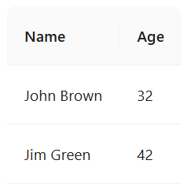
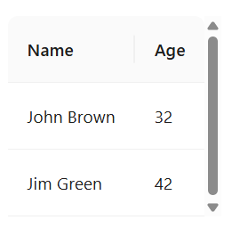

# #56115 v5→v6 升级后高度充足也冒出竖向滚动条（flex 堆叠场景）

## 现象
用户的用例：动态数量的 Table 纵向堆叠，外部用 `.ant-table-wrapper { overflow: auto }` 让空间不够时再出现滚动条，避免计算 `scroll.y`。
- v5.29.1：高度充足时无滚动条（预期）。
- v6.0.1：同样代码、同样数据，高度充足却出现一条多余竖向滚动条。

## 复现 / 触发条件
- 升级 antd 5.29.1 → 6.0.1
- 外层 `.ant-table-wrapper { overflow: auto }`
- 多表格 flex 纵向堆叠、动态数量、用户可指定部分表格高度
- 附完整示例 zip `table-scroll-style.zip`

## 期望 vs 实际
- 期望：升级 6.x 保持 v5 行为，空间足够时无滚动条。
- 实际：v6 冒出多余竖条，且用户的真实场景（flex 堆叠）无法用 `scroll.y` 替代——会触发"高度变化 → scroll.y 重算 → 高度再变"的循环，表格不停长高。

## 根因 / 关键讨论
dosubot 定性：**v6 内部滚动架构变了**，滚动/溢出由 rc-table + rc-virtual-list 统一管理，外层 `.ant-table-wrapper` 不再承担滚动区域。用户在 wrapper 上加 `overflow: auto` 会和内部滚动层冲突，导致即使没溢出也冒滚动条。dosubot 给的"用 `scroll.y` 替代 wrapper overflow"建议被作者直接驳掉——flex 堆叠下 scroll.y 会引起反馈循环（参考 #54881、#19705）。
- 没有 CSS-only/声明式方案能恢复 v5 行为。
- 权宜方案：只对 `.ant-table-body` 做 overflow，外层用 flex + `overflow: hidden`；或所有列指定 width 减少异步测量抖动（#55717）；或直接用 CSS `th { position: sticky }` 替代 antd `sticky` 属性（#55265）。

## 关联图片

## 对 data-grid 的启示
两条避坑：(1) **外层 wrapper 与表体 scroller 不要各自都开 `overflow: auto`**，统一由一处承担（CSS Grid 用单一 scroll container + grid track 接管即可天然避免）；(2) **`scroll.y` 这类 JS 测量驱动的尺寸 prop 在 flex 父容器下天然有反馈循环风险**，data-grid 应提供"自然高度 + 容器查询 / `scrollbar-gutter: stable`"的纯 CSS 模式，让用户像 v5 那样把滚动管理彻底外包给浏览器，不要逼用户算 `scroll.y`。
