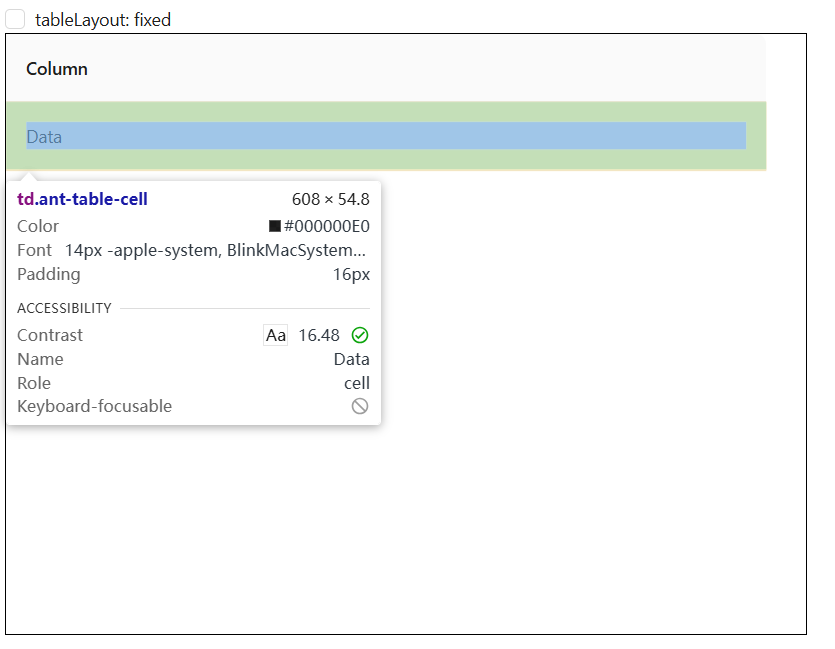

# #56477 tableLayout 非 fixed 时 rowSelection.columnWidth 无法设为 0

## 现象
作者要实现"单选但点击行内任意单元格选中"的交互（不显示选择列）。设置 `rowSelection.columnWidth: 0` + CSS `visibility: collapse` 隐藏 `.ant-table-selection-column`，但 `tableLayout` 未配置（auto）时**表格右侧出现约 32px 空白**；只有切到 `tableLayout: 'fixed'` 才能彻底消除空白。

## 复现 / 触发条件
- antd 6.x / React 19。
- `rowSelection: { type: 'radio', columnWidth: 0 }`。
- CSS: `.ant-table-selection-column { visibility: collapse; }` + `.ant-table-selection-col { visibility: collapse; }`。
- 外层 640×480 容器，单行单列数据。
- 切换 `tableLayout={undefined}` ↔ `'fixed'` 对比：auto 下右侧有 32px 空白。

## 期望 vs 实际
- 期望：`columnWidth: 0` + collapse CSS → 选择列真正消失，无空白。
- 实际：auto 布局下，浏览器仍给该列保留默认宽度 + padding，残留 32px 空白。

## 根因 / 关键讨论
dosubot 解释：这是 antd Table + rc-table 的**设计限制而非 bug**。
- `columnWidth: 0` 只是让该列的 width 属性变为 0，但 CSS 层 `.ant-table-selection-col` 仍会被应用默认宽度和 padding（约 32px）。
- 只有 `tableLayout: 'fixed'` 时浏览器才**严格按 width 属性渲染**，columnWidth: 0 才能真正隐藏。
- 相关 issue #54741。

workaround：
1. **抛弃 rowSelection**：自己用 `onRow/onCell` + `useState` 管理选中，配合 `rowClassName: 'ant-table-row-selected'` 借用 antd 默认选中样式。
2. 强制 CSS 覆盖：`width/min-width/max-width/padding/border/visibility: collapse !important;`（兼容性需测试）。
3. 接受 `tableLayout: 'fixed'`（但与 #56602 报告的 flex 布局 bug 冲突）。

## 关联图片
- 

## 对 data-grid 的启示
1. **支持真正 0 宽列**：CSS Grid 下 `grid-template-columns: 0px ...` 或 `display: none` 列 track 可彻底消除空白。`rowSelection.columnWidth: 0` 应原生支持而非依赖 `tableLayout: fixed`。这是 data-grid 结构性优势。
2. **`rowSelection` 应允许隐藏选择列保留高亮**：用户业务诉求是"无选择列 + 行选中高亮"。data-grid 应提供 `rowSelection.hideSelectionColumn: true`（或 `columnWidth: 0`）作为 first-class API，自动配合 `selectedRowKeys` 联动 `rowClassName`，免去用户自己 useState。
3. **`selectedRowKeys` 高亮独立于 rowSelection**：更彻底的解耦是让 `selectedRowKeys` 作为独立 prop 高亮行，`rowSelection` 只管选择 UI。data-grid 可重新设计 API 边界。
4. **对比 antd 32px 空白验证**：data-grid demo 应增加"rowSelection 隐藏选择列"用例，截图证明右侧无空白，作为差异化卖点。
