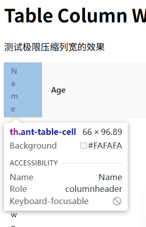

# #56602 表格列的最小宽度存在隐式的最小值限制

## 现象
作者要把某列压到 10px（用于行头操作按钮图标列）。即使同时设了 `width: 10` + `minWidth: 10` + `onCell/onHeaderCell` 清零 padding + 内容 `maxWidth: 10` + `overflow: hidden`，**实际渲染宽度仍为 66px**，无法压到目标 10px。

作者明确两个前提：
- 不能指定 `tableLayout`（因为 `fixed` 在 flex 布局中有 bug：外层 flex 容器变宽后变窄，表格宽度不会跟着变窄）。
- 不能指定 `scroll.y`（要绕其它 bug）。

## 复现 / 触发条件
- antd 6.1.4 / React 19.2 / Windows 11 25H2 / Edge。
- 3 列：第一列 `width:10, minWidth:10` + render 包在 `maxWidth:10` div 里 + `onCell/onHeaderCell` padding:0。
- 其余两列 `width: 1200`，`scroll={{ x: 2410 }}`。
- DevTools 实测：`table-layout: auto`（非 fixed），但首列实际 66px。

## 期望 vs 实际
- 期望：第一列按 `width: 10` 渲染 10px。
- 实际：渲染 66px，超出配置约 56px。

## 根因 / 关键讨论
- dosubot 起初误判为 `table-layout: fixed` 限制，作者纠正为 auto。
- 修正后共识：这是**浏览器原生 `<table>` 在 `table-layout: auto` 下的最小可用宽度**——浏览器保证单元格至少能容纳一个字符 + padding/border。Chrome/Edge 比 Firefox 更顽固。
- antd / rc-table 源码没有强制 min-width，完全交给浏览器 table 布局算法。
- JackyST0 建议 `tableLayout="fixed"` + `.ant-table-cell { min-width: 0 !important; }`；作者拒绝：fixed 在 flex 布局下有"无限变宽"bug。
- Starglen 总结：这是浏览器为保证可读性施加的合理最小宽度限制；workaround 包括绝对定位悬浮、`display: contents`、把操作按钮移到表格外。

## 关联图片
- 

## 对 data-grid 的启示
1. **CSS Grid 突破 `<table>` 最小宽度限制**：data-grid 用 `display: grid` 而非 `<table>`，grid track 可以**真正压到 0px 或 1px**（`grid-template-columns: 10px 1200px 1200px` 会严格生效），这是结构性优势。极窄图标列场景（本 issue 用例）可完美支持。
2. **`column-width-scrollbar-policy.md` 一致性**：规约已确立 `auto` 列用 `minmax(min-content, 1fr)`。但用户显式 `width: 10` 时应严格按 px 生效，不走 min-content。需在文档明确"显式 px width → 严格 px 渲染"语义。
3. **支持 `minWidth` 在所有模式下生效**：antd 的 `minWidth` 只在 `tableLayout: auto` 生效，fixed 被忽略。data-grid 应让 `minWidth`/`maxWidth` 在所有模式下都生效，作为列宽的硬约束。
4. **避免 antd 的 `tableLayout: fixed` flex 无限变宽 bug**：data-grid 应在 flex 容器中验证"父变宽→变窄，表格宽度严格跟随"，这是 antd 已知缺陷（用户拒绝 fixed 的核心理由）。
5. **极窄列场景验证用例**：增加 demo——`width: 10` 的图标按钮列，data-grid 应能严格 10px 渲染（对比 antd 66px 失败截图）。
