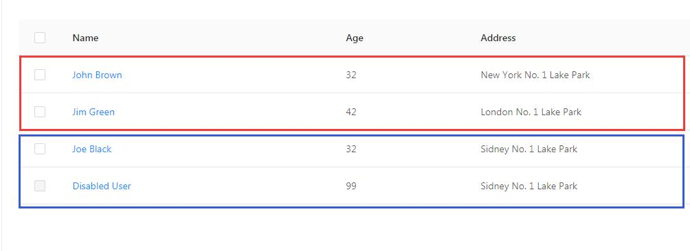
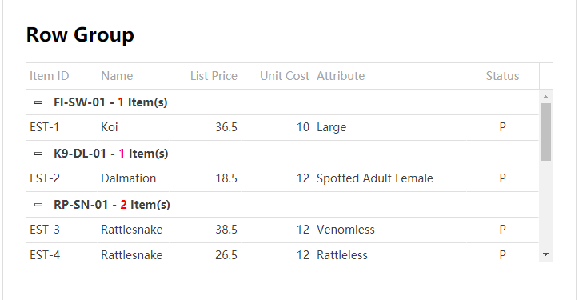

# #15630 请为表格 (Table) 组件添加一个数据行 (tr) 分组的功能

## 现象
antd Table 至今（跨越 6 年）未内置"按字段对数据行分组渲染"的能力。用户的诉求：将 `dataSource` 里"关联的多行"用边框/分组头包成一个整体展示，类似 jQuery UI / devextreme / ag-grid 的 row grouping。提议 API：

```ts
const data = [[{}, {}], [{}, {}], ...] // 二维数组，每个子数组 = 一个分组
<Table dataSource={data} />
// 或：groupField: string + renderGroup: ReactNode
```

社区后续强烈补强：不仅是视觉边框，还需要 **Group Summary（组小计）**、**Partial Group**、**分组折叠**等能力，参考 devextreme 的 Record Grouping demo。

## 复现 / 触发条件
- 任何 antd 版本都没有该能力；用户被迫用 `expandable.expandedRowRender`（语义不对：展开子表 ≠ 行分组）或自己在 `dataSource` 插入"伪数据行"作为分组头，后者会污染数据、与选择/排序/过滤耦合出 bug。
- 调组与组之间的间距会导致表格错乱（社区反馈）。

## 期望 vs 实际
- 期望：
  1. 按字段自动分组 + 分组头（可自定义 ReactNode）；
  2. 分组带视觉边框/底色，组与组之间有可控间距；
  3. 分组可折叠；
  4. Group Summary（组小计行）。
- 实际：antd 6.x 仍未提供；维护者早期说"HOC 更适合，不在 Table 上实现"，但 6 年来没有官方 HOC，issue 进入 `Inactive`。

## 根因 / 关键讨论
- 维护者 (afc163 等) 未正面接单，仅建议 "HOC"。
- 社区技术建议：用 `<table>` + 多个 `<tbody>` 实现分组，IE10+ 兼容（HTML 原生支持）。
- 关联 issue: #6895、#17254。
- 关键差异化反馈："这不是 colspan/rowspan（3.x demo）"——分组不改数据列结构，只在行级别加分组容器。
- 典型用例：订单按品类分组（家电 5000 / 家具 5000），数据保持原样、不插伪行。

## 关联图片
-  — OP 示意图：红框/蓝框区分两个行分组
-  — 社区贴的 jQuery UI 风格分组截图

## 对 data-grid 的启示
1. 这是 antd 长达 6 年未解的"高频诉求"，是 data-grid 拉开差异的**关键机会点**：原生提供 `rowGrouping` API（`groupField` / `renderGroupHeader` / `defaultExpandedGroups` / `groupSummary`）。
2. CSS Grid 实现行分组比 `<tbody>` 更自然：可以用命名行 `grid-template-rows: [group-1-start] auto 1fr [group-1-end group-2-start] ...` 让分组边框/间距通过 Grid 间隙直接表达，组间距用 `gap` 控制不会引起"表格错乱"。
3. 必须把"分组头"与"分组小计"作为**虚拟结构行**而非真实数据行，避免污染 `dataSource`（影响排序/过滤/选择）。
4. 与虚拟滚动共存：分组头/小计行需在虚拟化中以 sticky/重复渲染方式保持可见，参考 #36066 的"行吸顶"。
5. 与合并单元格（rowSpan）配合时要有明确规约——组内可 rowSpan，跨组禁止 rowSpan。
6. API 设计：`rowGrouping: { field: string; headerRender?: (group, rows) => ReactNode; summaryRender?: ...; defaultExpanded?: string[]; }`，对齐 ag-grid / devextreme 的成熟模型，降低用户迁移成本。
