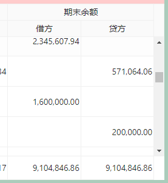

# #34129 Table 总结栏使用ColSpan前后风格不一致

## 现象
antd 4.18.7 下，`<Table summary>` 中如果不调用 `ColSpan`（或 `colSpan=1`），总结栏最右下角单元格与表头/表体最右侧列的样式对不齐：没有给垂直滚动条预留宽度、右上角边框视觉上突出，导致强迫症用户难以接受。一旦总结栏里用过 `colSpan`（哪怕值就是 1），样式分支就切换到了另一种渲染风格，前后两套外观不一致。

## 复现 / 触发条件
- antd 4.18.7 + React 16.14 / Edge 96 / Win10。
- 在 `<Table summary={...}>` 内 `Cell` 不使用 `colSpan` vs 使用 `colSpan={1}` 切换即可看到不同样式。
- 链接：原始 issue 未贴在线复现，仅贴对比截图。

## 期望 vs 实际
- 期望：总结栏不论是否使用 colSpan，右下角单元格都与表头/表体最右列对齐，并预留滚动条宽度；右边框正常。
- 实际：不使用 colSpan 时最右下角单元格风格不一致、没有滚动条占位、右上角边框奇怪；使用 colSpan 后样式恢复正常。

## 根因 / 关键讨论
维护者实测对比："标题 601.38px，内容 600px，总结栏 601.38px"——看起来是列宽/边框精度累加造成的亚像素错位（不同分支走的样式表不同，最终渲染宽度被压成不同的小数值）。社区指出 summary 完全自定义，用户可"自己加个空的 `<Cell/>`"作为滚动条占位来规避；但根因仍在于 summary 内部根据是否 colSpan 走了不同样式分支。后续被标记 `help wanted`，但 2025 年后进入 `Inactive`。

## 关联图片
-  — 不使用 colSpan 时右下角与右上角异常对比
-  — 使用 colSpan 前后风格差异

## 对 data-grid 的启示
1. summary 单元格样式必须只走单一分支，绝不能因"是否声明 colSpan=1"产生分歧；内部对 `colSpan===1 || undefined` 要归一化。
2. 滚动条占位（gutter cell）要在 summary/表头/表体三处同步出现，避免一栏漏占位导致强迫症级错位；CSS Grid 下可考虑用 `grid-template-columns` 显式给 `scrollbar-gutter: stable` 一列。
3. 警惕亚像素累加：使用 Grid 时优先让浏览器自己分配（`fr` / `minmax`），不要在三套区域里各自算 px 宽度再相加，否则会重蹈 601.38 vs 600 这种精度漂移。
