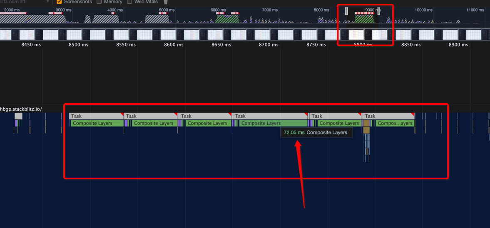
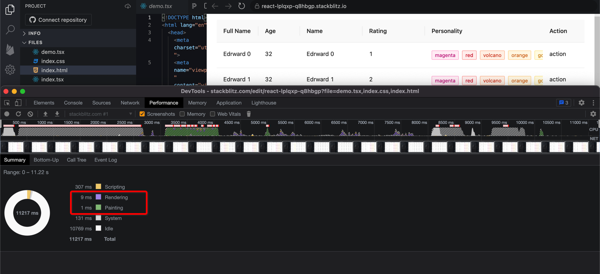

# #35241 antd-table 性能问题（box-shadow 横向滚动掉帧）

## 现象
生产环境中，大表格（多 cell + 横向滚动）横向拖动时肉眼可见掉帧。根因是固定列（fixed left/right）两侧的 `box-shadow` 在每帧 paint/rendering 时被浏览器反复重绘。删除阴影后流畅度大幅提升。

## 复现 / 触发条件
1. 列数与每页数据足够多（每行行高 28px、每页 100 条、视窗拉宽）；
2. 开启 `scroll.x` + 多个 `fixed: 'left' | 'right'` 列（产生阴影边界）；
3. 每个 cell 还有自定义复杂渲染（如 Tag、链接）；
4. 横向滚动到 Tag 附近尤其掉帧（在中低配 2015 MacBook Pro 2.2GHz 16GB 实测）。

## 期望 vs 实际
- **期望**：保留 fixed 列视觉提示的同时，横向滚动 ≥55fps。
- **实际**：阴影导致 paint/rendering 耗时大幅上涨，肉眼掉帧。

## 根因 / 关键讨论
- 报告者（muzea）+ 作者（ymoon）反复横跳找到根因：
  - 每个 cell 自带 `overflow: hidden` 等触发重绘的 CSS；
  - fixed 列的 `box-shadow` 与大量 DOM 叠加，使浏览器 blending 耗时成为瓶颈；
  - 手动删除 box-shadow 后 profile 显示 paint/rendering 几乎被消灭。
- 提出的优化方向：用静态 image 纵向拉伸替代 box-shadow，减少 blending。
- zombieJ 回复"找到原因了，可以一起看看怎么在保留 shadow 的同时修复"，但 2023-09 后无后续，标 Inactive。

## 关联图片
- `assets/35241-1.png` — 症状：横滑掉帧现象 + Tag 行截图。
- `assets/35241-2.png` — Profile：删除 box-shadow 前后 rendering/paint 耗时对比。

## 对 data-grid 的启示
1. **避坑核心**：固定列边界提示**不要用 box-shadow**，改用 1px 边框 + 渐变 mask image（纵向 stretch），或 `linear-gradient` 作为背景。data-grid 的 sticky 列实现可直接走此路。
2. 性能验证矩阵：大表格（100+ 行 × 20+ 列，多 Tag 渲染）+ 横向滚动 60fps A/B 测试，对比 antd。
3. 警惕每 cell `overflow: hidden` 累积——data-grid 用 CSS Grid 时，overflow 应放在 row 容器或表体容器层，不要每 cell 都开。
4. 这是 antd 多年未解的性能瓶颈，data-grid 用 image/gradient 替代阴影即可明显领先。
5. 与 data-grid 的"虚拟滚动是唯一性能痛点"记忆吻合——横向滚动叠加阴影是另一个被忽视的瓶颈。
