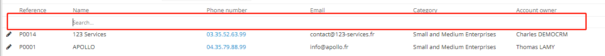
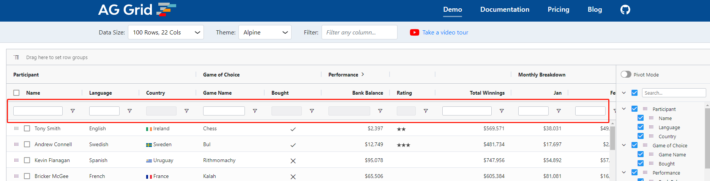

# #41306 表格首行支持过滤

## 现象
国内常见列表页把搜索条件区独立在表格上方；而 Radzen Blazor DataGrid、ag-Grid 等国外组件在表头下方紧跟一行输入框（filter row），让用户像 Excel 一样直接按列过滤，效率更高。

## 复现 / 触发条件
当前 antd Table 只支持 `filterDropdown`（点开下拉菜单过滤），没有"表头下嵌入一行 input"的内置模式。

## 期望 vs 实际
- **期望**：提供 `allowHeadRowFilter={true}` 之类的开关，渲染表头过滤行。
- **实际**：需要业务自己写 `components.header.cells` 大量自定义，且难以与列定义、filteredValue 联动。

## 根因 / 关键讨论
作者附了 Radzen 与 ag-Grid 的截图作为参考。维护者机器人自动回复欢迎 PR（标 help wanted + 💄 Design），意味着方向被接受但无人实现。多年过去仍是 Inactive 状态。

## 关联图片
- `assets/41306-1.png` — Radzen DataGrid simple filter menu 参考截图。
- `assets/41306-2.png` — ag-Grid 内置 filter row 参考截图。

## 对 data-grid 的启示
1. data-grid 用 CSS Grid 重做表头时，可天然把 header 拆成多行（`grid-template-rows: title filter`），新增 `column.filterMode = 'row' | 'menu'` 比侵入式 filterDropdown 更干净。
2. filter row 应支持 input、select、date-picker 等多种控件，并复用 `filteredValue` 受控语义、与排序/分页互不干扰。
3. 注意 sticky 表头时，filter row 要随表头一起 sticky，不能脱节——这是 ag-Grid 做得好的点。
4. 交互上参考 Radzen：equal/not contains/starts with/between 等条件切换应嵌入同一行，不破坏列宽。
5. 从 antd 的接受但未落地看，这是 data-grid 容易拉开差异化的卖点。
