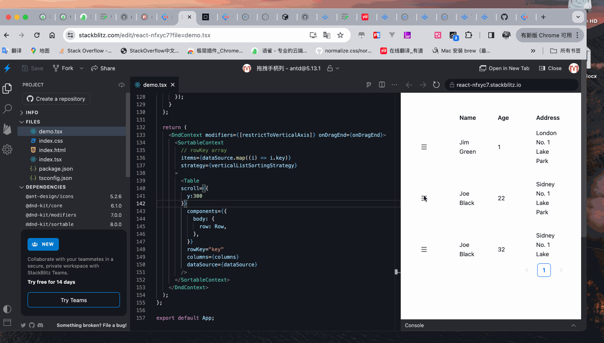

# #47012 scroll + dnd-kit 拖拽到底部频繁闪动

## 现象
antd v5 Table 设置 `scroll={{ y: 300 }}` 后，与 dnd-kit 结合做手柄拖拽排序，把行拖向表格底部接近可视区边缘时，整个表格出现频繁闪动，无法稳定放置。

## 复现 / 触发条件
1. 使用 antd 官网"拖拽手柄列" demo（基于 dnd-kit）；
2. 设置 `scroll={{ y: 300 }}`；
3. 拖动第二行向底部方向移动；
4. 拖到接近底部时，表格内容反复重排/抖动。

复现：https://stackblitz.com/edit/react-nfxyc7?file=demo.tsx

## 期望 vs 实际
- **期望**：拖到底部应平滑触发自动滚动并允许释放，不抖动。
- **实际**：dnd-kit 的 auto-scroller 与 antd 表体内部滚动容器（rc-virtual-list / 内部 `div.ant-table-body`）发生 scroll 边界冲突，互相覆盖 scrollTop，造成抖动。

## 根因 / 关键讨论
报告者附了 `bugshow.gif` 实拍闪动。无官方回复，标签 Inactive + unconfirmed。推测根因：
- antd Table 内部有多层滚动容器（表体 / virtual holder），dnd-kit 默认对最近的可滚动祖先做 auto-scroll；
- 当滚动容器位置/尺寸被 React 重渲染改动时，dnd-kit 计算的边界值过时，触发"滚动—重排—反向滚动"循环；
- 拖拽时业务往往用 `setState` 重新设置 `dataSource`，触发 antd Table 整体重渲染，进一步放大抖动。

## 关联图片
- `assets/47012-1.gif` — 拖到底部频繁闪动实拍。

## 对 data-grid 的启示
1. data-grid 的虚拟滚动 + 拖拽排序组合（行重排）必须作为一等场景测试，避免重蹈：拖拽中**不要**因 dataSource 变更触发表体重渲染——应走 visual feedback（CSS transform），drop 时才落盘。
2. 滚动容器层级要扁平，单一可滚动祖先，让 dnd-kit 等第三方 auto-scroller 能稳定锁定目标。
3. 自动滚动边界计算用 `ResizeObserver`/`useLayoutEffect` 维护最新值，而非每次 drag move 时再读。
4. 提供 `onRowDragStart / onRowDragEnd` 受控 API，使用方在 dragStart 暂停虚拟化或固定视口高度，drop 再恢复。
5. 这是社区高频痛点，data-grid 可作为差异化体验。
