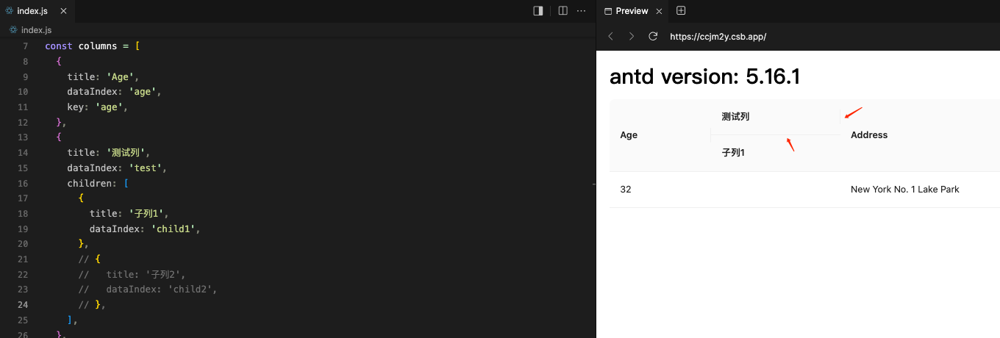

# #48385 Table 没有 border 时，columns 存在只有一列的子列下的样式问题

## 现象
antd 5.16.1 / React 17 / macOS / Chrome。当 `columns` 中某列的 `children` 只有一列子列时（即父子结构落到底层只有 1 个叶子列），在 `bordered=false` 状态下出现两个样式瑕疵：
1. 父级表头与子级表头之间多出一条横线；
2. 父级右侧的竖线出现在"上方"而不是"垂直居中"位置。
期望：父子之间没有横线，父级右侧竖线居中。

## 复现 / 触发条件
- `columns: [{ title: '父', children: [{ title: '子', dataIndex: 'a' }] }, ...]`，不设 `bordered`。
- CodeSandbox: https://codesandbox.io/p/sandbox/antd-reproduction-template-forked-z68yqf?file=%2Findex.js%3A25%2C7
- 复现体感：单列子列时父级表头与子级表头之间的分隔线显得突兀；多个子列时，右半部分居中位置的竖线也会缺失。

## 期望 vs 实际
- 期望：父子表头之间无横线；父级右侧竖线居中。
- 实际：父子之间有横线，右侧竖线偏上；多子列时居中竖线也丢失。

## 根因 / 关键讨论
讨论指出："都是 `::before` 导致的"——antd Table 用 `::before` 伪元素绘制表头分隔竖线，但当某个父列只有 1 个子列时，伪元素的定位与"分割多列"的预期不一致，于是横线/竖线出现在错误位置。社区建议："在没有 bordered 的情况下，把所有的竖线都去掉"以简化分支。维护者回复"mark 下，周末改下"，但后续进入 `Inactive`。

## 关联图片
-  — 单子列下父子表头之间的异常分隔线

## 对 data-grid 的启示
1. 表头分组（multi-row header）渲染时，对"父列只有 1 个子列"这种塌缩情形应做归一化——要么警告/合并，要么按"父级直接作为叶子"渲染，不要保留 2 行表头只装一个单元格。
2. CSS Grid 表头用 `grid-row: span N` 自然处理父子跨行，不需要 `::before` 伪元素绘制分隔线，可避免这类伪元素定位 bug；分隔线应直接用 `border` 或 Grid 的 `gap` + 背景色实现。
3. "bordered / no-bordered"两套边框逻辑应共用同一渲染结构，仅在边框宽度上切换，不要走两套完全不同的 DOM/伪元素布局，否则会出现只有一侧出现的诡异样式。
