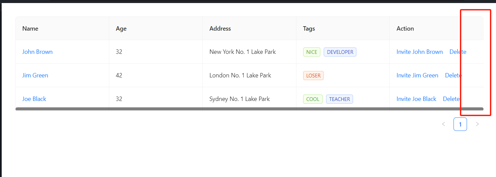

# #50957 Table组件设置virtual模式后在2k分辨率屏幕下会显示滚动条

## 现象
2K 分辨率屏幕（系统默认推荐 125% DPI 缩放）下，Table 同时开启 `virtual` 与 `bordered` 后，即使内容未溢出也会多出滚动条，且右侧边框消失。把浏览器缩放比例改回 80% 或切回 1080 屏幕恢复正常。

## 复现 / 触发条件
- 2K 屏 + Windows 系统缩放 125%（默认推荐值）
- `<Table virtual bordered />` 且内容没有溢出
- 复现仓库：StackBlitz `antd-reproduce-5x-w2h2zc`，antd 5.21.0 / React 18 / Win11 / Chrome

## 期望 vs 实际
- 期望：内容未溢出时不显示滚动条、右侧边框正常渲染。
- 实际：未溢出也冒出滚动条，并把右边框挤出可视区。

## 根因 / 关键讨论
维护者 zombieJ 一句话定性：「Windows 日经问题，系统缩放后丢失精度导致。代码侧拿到的已经是丢失精度后的数据了。」即浏览器在非整数 DPR 下报上来的 clientWidth/scrollWidth 已经含亚像素误差，组件侧用整数比较就会误判为"溢出 → 显示滚动条"。作者追问有无解法，无人接招，issue 被打上 Inactive 搁置。

## 关联图片

## 对 data-grid 的启示
CSS Grid 重做 Table 时，判断"是否需要滚动条"不要拿整数像素做严格等号比较，应当允许亚像素容差（如 `scrollWidth - clientWidth > 1`）或基于 `ResizeObserver` 的 contentBoxSize 做分数运算，规避 Windows 缩放丢精度陷阱。
