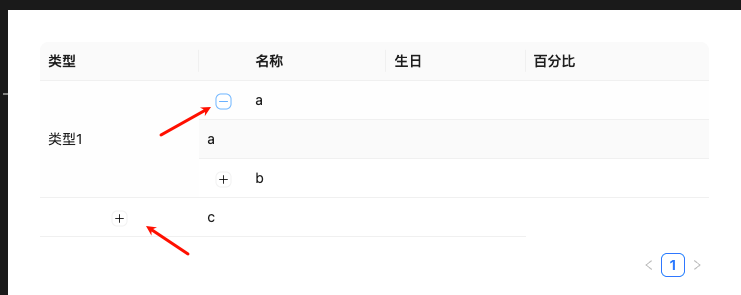

# #53862 Table 展开使用合并单元格使用有问题

## 现象
antd 5.25.1 / macOS / Chrome。同时使用 `expandable`（展开行）与 `rowSpan`（合并单元格）时，展开第一行后合并单元格的渲染错乱：合并的 rowSpan 没有把"展开行插入的那一行"算进去，导致合并范围与实际 DOM 行数不匹配，渲染出现错位。

## 复现 / 触发条件
- antd 5.25.1，开启 `expandable.expandedRowRender` + 列 `onCell` 返回 `rowSpan`。
- 步骤："打开 demo，展开第一行"——展开后合并单元格视觉错位。
- OP 没贴独立 codesandbox，issue 描述极简（"没问题 / 有问题"）。

## 期望 vs 实际
- 期望：展开行的插入不影响 rowSpan 的合并行数，渲染正常。
- 实际：展开行占了一行 DOM，但 `rowSpan` 没有相应 +1，合并单元格被撑断或越界。

## 根因 / 关键讨论
- 维护者（crazyair 自己也是 antd 成员）说："不支持聚合展开，不过看起来这个样式还挺合理的？可以搞一下"——即承认当前不支持，但有意愿做。
- 讨论 `"要自己判断是否展开了，rowSpan + 1"`、`"没那么简单，还要判断展开是第几行，需要给哪个 + 1"` —— 说明根本症结：`rowSpan` 是声明式的（合并 N 个原始数据行），但展开行是命令式插入的额外 `<tr>`，二者坐标系不一致。
- 关联 PR: `react-component/table#1276`（尚未合并）。
- Related issues: #24740（expandable 自定义 td）、#34144（动态计算 rowSpan）、#46796（树形表格 + 合并 index 错位）。

## 关联图片
-  — 展开 + 合并单元格的错位示意

## 对 data-grid 的启示
1. 这是合并单元格的"蛇打七寸"之一：CSS Grid 下应让 rowSpan 用 `grid-row: span N` 表达，而展开行也用 `grid-row` 占一行；二者的坐标系必须统一到"实际渲染行"而非"原始 dataIndex 行"。如果 rowSpan 用"数据行索引"表达，遇到展开行/树形子节点就会崩。
2. 建议提供"展开行注入到合并单元格之内"的明确语义：合并单元格的 rowSpan 是否覆盖展开行，需要 API 明示（例如 `rowSpanIncludesExpandedRow: boolean`），别让用户自己 +1。
3. 必备回归用例：展开任意一行后，相邻的 rowSpan 合并单元格渲染不漂；树形表格 + rowSpan 也要覆盖（参考 #46796）。
4. 文档警告：当前若同时使用 expandable + rowSpan，需要业务侧自己调整 rowSpan——data-grid 应把这个坑在文档显著位置标出，最好提供官方聚合展开方案。
