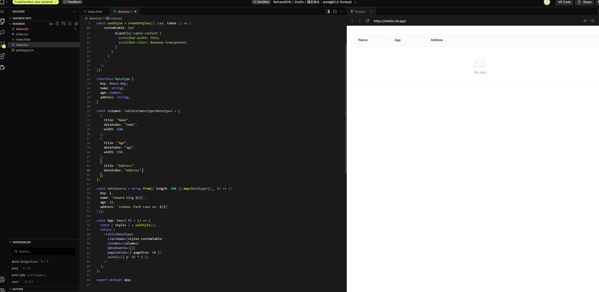

# #56151 无数据时表格宽度自动缩减（Windows Chrome 滚动条占位 bug）

## 现象
作者在 Windows Chrome 上发现：当 `dataSource: []`（空数据）时，Table 表头列宽与有数据时**不一致**——空表右侧空出很大一块。所有 columns 都设了 width，本应严格按 width 渲染。

## 复现 / 触发条件
- antd 6.1.0 / React 19 / Windows / Chrome。
- 所有 columns 显式 width。
- `dataSource: []` 对比有数据。
- CodeSandbox: https://codesandbox.io/p/devbox/gu-ding-biao-tou-antd-6-1-0-forked-4srklj

## 期望 vs 实际
- 期望：空表与有数据时列宽一致。
- 实际：Windows Chrome 下空表右侧出现大块空白；Mac Chrome 渲染正确；Linux arch+kde+Chrome 143 也不正常。

## 根因 / 关键讨论（★ 重要）
- dosubot 解释：rc-table 的设计 + Windows/Chrome 浏览器为滚动条预留空间，表头/内容宽度不一致。建议升级到 rc-table@7.52.7+ 或留一列不设 width。
- **antonabramovich 关键发现**：Mac Chrome 渲染正确，Windows Chrome 渲染异常；他在 #55094 早已报告相近现象。
- **fnoopv 确认 Linux arch+kde+Chrome 143 也复现**——不是单一平台 bug。
- **dislido 给出根因**（最关键）："**数据为空时，ant-table-cell-scrollbar 缺少 colgroup 会占用剩余空间**"。
- 维护者 afc163 长期 Need Reproduce 后移除，说明确实存在但难复现（需特定平台）。
- 关联 issue 族（用户横跨多个相似 bug）：#55094、#56357、#56479、#56713、#57365、pro-components#9424。

## 关联图片
- 

## 对 data-grid 的启示（★ 本批次重要根因）
1. **CSS Grid 单 colgroup 天然免疫**：dislido 指出 antd 病根是"空数据时缺少 colgroup → ant-table-cell-scrollbar 占用剩余空间"。data-grid 用 `grid-template-columns` 在表头与表体共享同一套列定义（`gridtable-stage3-architecture.md`），**不存在"空数据丢 colgroup"**的情况，结构性避开该现象。
2. **跨浏览器滚动条宽度差异测试矩阵**：本 issue 表明 Mac/Windows/Linux Chrome 对滚动条占位处理不同（Mac overlay 不占位，Windows classic 占位 ~15px，Linux 各发行版差异大）。data-grid 必须三平台都验证空表列宽与有数据时严格一致。已有 `column-width-scrollbar-policy.md` 规约"横滚条永不占布局"，应增加"空表竖滚条占位测试用例"。
3. **空数据 demo 应作标配**：data-grid 默认 demo 矩阵里应包含"空数据 + scroll.y + 所有列定宽"用例，对比 antd 失败截图作为差异化卖点。
4. **`column-width-scrollbar-policy.md` 可直接引用此 issue 作依据**：本 issue 是"滚动条占布局会导致诡异 bug"的最强证据，可在规约中标注。
5. **滚动条占位是 antd 已知缺陷族**：#56357/#56479/#56713/#57365 全是同族。data-grid 设计上避开这组现象。
