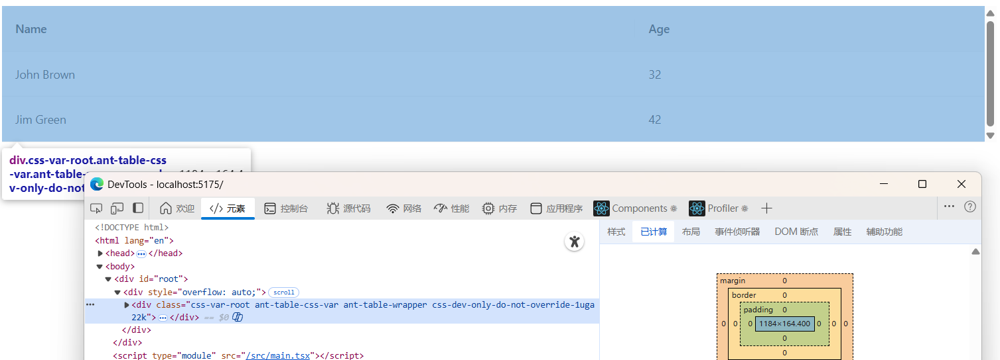

# #56357 v5→v6 升级后表格外层 div 出现多余竖向滚动条

## 现象
从 antd v5 升级到 v6.1.2 后，**Table 外层 wrapper div**（用户自己的 `overflow: "auto"` 容器）出现了一条多余的竖向滚动条，即使内容高度没有超出。v5 同样代码无此问题。

## 复现 / 触发条件
- antd 6.1.2 + React 19 + Windows 11 25H2 + Edge 143（Chrome 同样）
- 复现仓库：`github.com/JamesFiitWork/Antd6BugTableContainerScrollBar`（核心代码在 `App.tsx` L42，没有任何自定义表格样式）
- 用户的吐槽：「总不能让我自己给表格加 padding 吧？这样写以后怎么维护呢？」

## 期望 vs 实际
- 期望：表格外层容器不应冒出多余竖滚动条。
- 实际：v6 下出现，v5 无此问题。

## 根因 / 关键讨论
dosubot 定性：v6 改用了新的 CSS-in-JS 样式与 rc-table 集成方式，Table 外层容器的 `overflow` / `maxWidth` / `scrollbarColor` 等都变得"更严格"，在 Windows/Edge/Chrome 这类会**预留滚动条空间**的浏览器下尤其容易冒出"多余"滚动条（即 antd 内部表体 scroll 容器算出的高度比外层多出 scrollbar-gutter 那一点）。临时缓解：
- `tableLayout="auto"` + `scroll={{ x: 'max-content' }}` + 至少一列不设 width；
- 或 `.ant-table-body table { width: auto !important; }`；
- 或 jinxiangqiang 给的 `.ant-table-cell-scrollbar { width: 6px; }`（减小占位宽度避免溢出）。
- 关联：dosubot 提到 rc-table 7.52.7+ 有相关修复（PR #54899、issue #55187），并辨析了 `rc-table` 与 `@rc-component/table` 是两个不同的包——前者是 antd v6 实际依赖，后者是未来实验性包。
- 关联 issue：#56479（scroll.y 改自动后固定列错位）、#56743（virtual + bordered 横向滚动条恒显）。

## 关联图片

## 对 data-grid 的启示
v6 这个回归警示：**表体内部滚动容器与外层用户容器的 scrollbar-gutter 必须显式协调**。CSS Grid 重做时应给 `.dg-wrapper` 设 `scrollbar-gutter: stable`（或把表体内部 scroller 与外部 wrapper 合一），并把内部 ant-table-cell-scrollbar 那种"占位 th"彻底干掉（用 grid track 替代），否则在 Windows 系滚动条占位的浏览器下极易冒出"幽灵竖条"。
