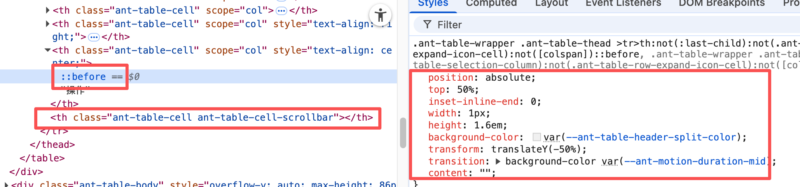

# #56713 scroll.y + 空数据：scrollbar 占位 th 导致列宽跳动

## 现象
设置 `scroll={{ y: 200 }}` 后，antd 在表头末尾插入占位 `<th class="ant-table-cell-scrollbar">` 用来给原生竖向滚动条留位。
- **空数据时**：该占位 th 与其他 th 一起被浏览器按比例平分宽度（没有显式 width），各列宽度都是浮动的"平均数"。
- **有数据后**：antd 给该占位 th 动态写入 `width: 15px`，其它列也获得测量后的实际宽度。
→ 两次状态间的列宽差值很大，UI 明显跳动。

## 复现 / 触发条件
- `<Table scroll={{ y: 200 }} />`，dataSource 从空 → 有数据切换
- 列数越少跳动越明显（差值被放大）
- Windows / Linux 的 Chrome / Edge 显著；Mac / Firefox 基本正常
- 复现：`stackblitz.com/edit/j8g44y4x` 及 `j8g44y4x-hhjcp2uy`
- antd 5.27.3、5.29.2、5.29.3、6.2.1 全部复现

## 期望 vs 实际
- 期望：空数据时也在 colgroup 里显式 `<col style="width: 15px;" />` 给占位列固定宽度，使两态宽度一致。
- 实际：空数据 colgroup 只有 selection col，scrollbar col 缺失；有数据才补上。

## 根因 / 关键讨论
- dosubot 先宣称 rc-table 7.52.7（antd 5.27.3+）已修复，作者实测 5.29.2/6.2.1 依然复现；5.29.3 也未修。
- 根因：rc-table 在 `dataSource` 为空时，scrollbar 占位 th 没有对应的 `<col>`，浏览器自动分配剩余宽度。这部分逻辑完全在 rc-table 内部，未暴露自定义 colgroup 的 API。
- 维护者 **huchaolin** 给出标准 HTML 解法：参考 MDN `<colgroup>`，对未明确宽度的列用无属性的 `<col />` 跳过，再为后续已知列（如 scrollbar 占位列 15px）显式设 width。
- 作者附带反馈：当 y 轴滚动条出现时，最后一列还会"莫名其妙多出一个分隔符"（即 `th::before` 分割线），需要再用 `.ant-table-wrapper :not(.ant-table-expanded-row) th.ant-table-cell:nth-last-of-type(2)::before { opacity: 0; }` 兜底。
- MadCcc 一度要求补录屏，作者已补 mp4。ZhaoFxxkSky 2026-04-30 仍追问"有计划修改吗"——至今未解决。

## 关联图片

（原帖另有 mp4 录屏 `antd@6.2.1.duplicated.-.StackBlitz.-.Google.Chrome.2026-02-09.10-42-04.mp4` 与 alipay objects 上的 reproduce.gif，需登录 GitHub / 内网访问才能查看。）

## 对 data-grid 的启示
CSS Grid 重做 Table 时彻底避坑：**列宽真理源永远在 `grid-template-columns`**，滚动条占位本身用一条独立的 grid track（如 `minmax(0, 15px)`）而非插入额外 th，从源头消灭"空/非空两套 colgroup"的分叉；分隔线 (`::before`) 也要绑定 grid 轨道而非 th 索引，避免 antd 这种"出现滚动条就多出最后一条分隔线"的副作用。
